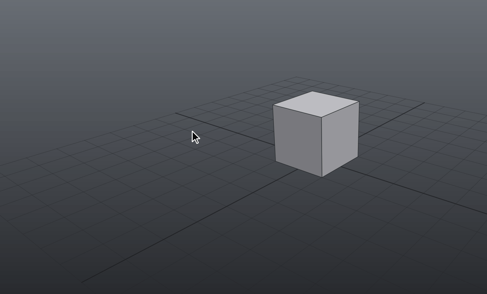
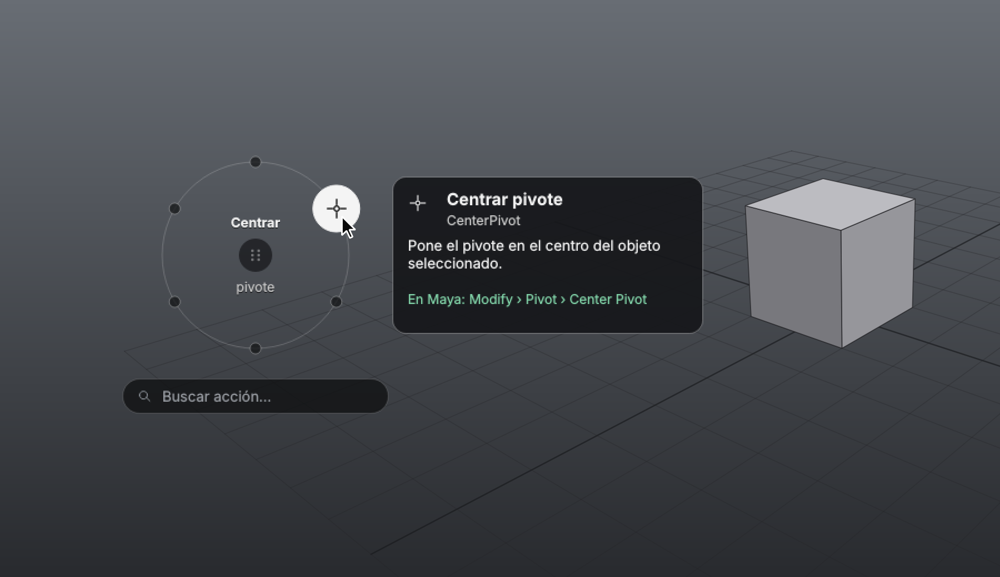
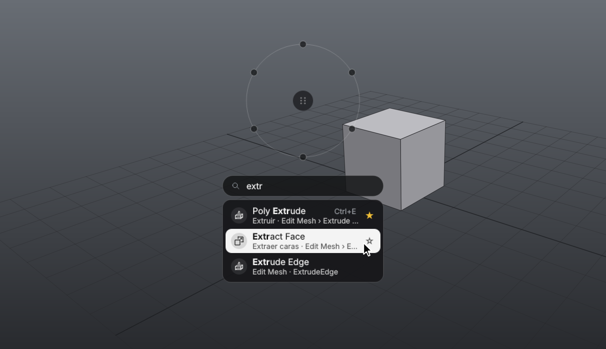
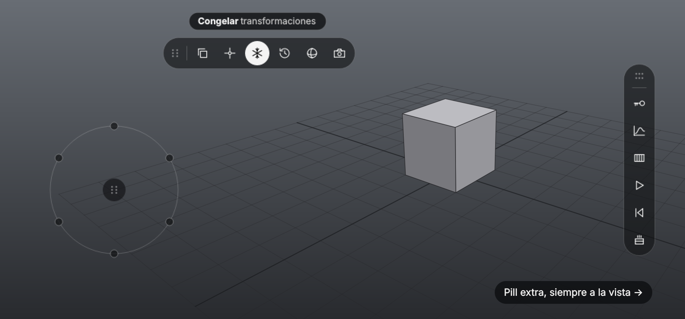
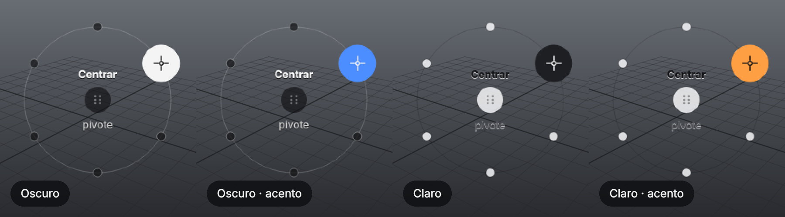

# Radial

Menú flotante para Autodesk Maya 2026 y 2027, en Windows y macOS.
Pon el ratón sobre un visor y pulsa **Tab dos veces rápido**: aparece el menú. Otro doble Tab lo oculta.
Cada botón lanza la orden de Maya que tú elijas.



- **Gesto rápido**: Tab, Tab mantenido, mueve el ratón hacia un botón y suelta.
- Dos formas a juego: **radial** (un anillo de puntos) y **pill** (una cápsula, horizontal o vertical), de 2 a 12 botones.
- Cada botón puede ser un comando de Maya, un botón de cualquier estante, código Python o MEL, un interruptor o una carpeta.
- **Buscador** debajo del menú, en inglés y en español: órdenes de Maya, sus menús, tus estantes y tus scripts.
- **Botón con lo último que hice**: convierte lo que acabas de hacer en un botón, sin escribir código.
- Para clase: **modo aprendizaje**, **modo reto** para aprender los atajos, **paquete de clase** y opciones que fija el profesor.
- Tema oscuro o claro, color de acento, iconos de Radial o de Maya, e interfaz en español o en inglés.
- Se guarda, se exporta y se comparte como un archivo `.radial`. No cambia ningún atajo de Maya.

No necesita instalar nada más: funciona con el Python que trae Maya. Versión **1.3.1**.

> *English summary:* Radial is a floating menu for Maya 2026/2027 (Windows and macOS). Hover a viewport and
> press **Tab twice quickly** to show or hide it, or hold the second Tab, flick towards a button and release.
> Buttons can run any Maya command, a shelf button, Python or MEL. Comes as a ring or a pill (2 to 12
> buttons), with a bilingual action search, a learning mode, a shortcut quiz, class packs, light and dark
> themes and an English interface (Settings › Appearance). Install by dragging `instalar.py` into the
> viewport. MIT licence.

## Instalar

1. Descarga o clona esta carpeta donde quieras dejarla, por ejemplo `Documentos/Plugins/Radial`.
   No la muevas después de instalar (si la mueves, repite el paso 2).
2. Abre Maya y **arrastra el archivo `instalar.py` hasta el visor**.

Aparece el menú **Radial** en la barra de Maya y el plugin se cargará solo cada vez que abras Maya.
Si algo falla, usa **Radial > Comprobar instalación**.

Para actualizar a una versión nueva, sustituye la carpeta y vuelve a arrastrar `instalar.py`.
Tus radiales y ajustes se conservan.

## Cómo se usa

| Qué | Cómo |
| --- | --- |
| Mostrar u ocultar el menú | Tab dos veces rápido con el ratón sobre un visor 3D, o **Radial > Mostrar/ocultar menú** |
| Gesto rápido | Tab, Tab **y mantén el segundo**; mueve el ratón hacia un botón y suelta: se ejecuta y el menú se cierra. Si sueltas sin moverte, el menú se queda abierto |
| Usar un botón | Acerca el ratón: el botón se vuelve blanco y aparece su nombre. Haz clic |
| Mover el menú | Arrástralo desde el centro (en la pill, desde los puntitos del extremo). Recuerda dónde lo dejas |
| Buscar y lanzar cualquier orden | Clic en el buscador de debajo del menú, escribe y elige (↑ ↓ e Intro, o clic). Esc devuelve el teclado a Maya |
| Poner una orden en un botón | Arrastra hasta un punto del menú un resultado del buscador, un botón de un estante o código seleccionado del Script Editor |
| Copiar un botón a otro menú | Pulsa un botón y arrástralo a un punto del otro menú (o de la pill extra) |
| Crear un botón con lo que acabas de hacer | **Radial > Crear botón con lo último que hice…** |
| Cambiar los botones | Clic derecho en el centro, o **Radial > Configurar botones** |
| Cambiar de radial | **Radial > Radiales** |
| Radial o pill | **Radial > Forma**, o en **Radial > Ajustes** |
| Tamaño, opacidad, número de botones y velocidad | **Radial > Ajustes** (se ve al momento en el menú) |
| Tema, color de acento, iconos e idioma | **Radial > Ajustes > Aspecto** |
| Volver a sacarlo bajo el ratón | **Radial > Volver a sacar el menú bajo el ratón** |
| Usar además un atajo | **Radial > Ajustes > Menú > Atajo de teclado** (por ejemplo Ctrl+Alt+R). Necesita Ctrl, Alt o Cmd y no deja elegir un atajo que Maya ya use. También en el Editor de atajos, categoría *Custom Scripts*: `RadialMostrarOcultar` y `RadialConfigurar` |

El menú sigue a la vista después de pulsar un botón, hasta el siguiente doble Tab.
Fuera de los botones, la línea y el centro, los clics pasan a Maya, así que puedes seguir trabajando con él abierto.

### Cuándo cuenta el doble Tab

- Los dos Tab tienen que llegar en menos de 250 ms (se cambia en Ajustes, entre 150 y 400 ms).
- El primer Tab llega a Maya como siempre; el plugin solo se queda con el segundo.
- No cuenta con Mayúsculas, Ctrl, Cmd u Opción pulsadas. Mantener Tab pulsado sigue siendo de Maya:
  el plugin solo sigue el segundo Tab de un doble Tab (el del gesto rápido).
- No cuenta mientras escribes en un campo de texto, el Script Editor o la Caja de canales.
- Con el menú oculto solo cuenta sobre un visor 3D, así que el Tab del Editor de nodos y del
  Hypershade (abrir el buscador de nodos) funciona igual que siempre.



## Buscador de acciones



Debajo del radial y de la pill hay una barra **Buscar acción…**. Haz clic en ella y escribe: salen las
órdenes de Maya (las del Editor de atajos) y los botones de tus estantes que coinciden, con su menú y el
nombre del comando. Las palabras pueden ir en cualquier orden («uv editor» o «editor uv») y no importan
las tildes ni las mayúsculas. Antes de escribir enseña las últimas que has usado.

Busca a la vez en **inglés y en español**: «extrude» y «extruir» encuentran lo mismo, y «centrar pivote»,
«biselar» o «congelar» encuentran `CenterPivot`, `BevelPolygon` y `FreezeTransformations`. Las órdenes que
no tienen traducción también salen en español gracias a un glosario de palabras
(`i18n/glosario_es.json`: «seleccionar todo» encuentra `SelectAll`). Cada resultado lleva el **icono de la
herramienta en Maya** (o la inicial si Maya no tiene icono para ella), el nombre de Maya en inglés con el
español debajo, y a la derecha su atajo de teclado si tiene.

- **↑ ↓** para elegir, **Intro** o clic para ejecutar. Con **Mayús** (Mayús + Intro o Mayús + clic) se
  abre su ventana de opciones. **Esc** borra y devuelve el teclado a Maya.
- Mientras escribes, Maya no recibe tus teclas, así que no se dispara ningún atajo.
- **Arrastra un resultado hasta un botón** del menú para ponerlo en ese botón (luego guarda el radial).
- La **estrella** de la derecha guarda la orden en **Favoritas**: salen las primeras al abrir el buscador
  sin escribir nada, y suben en los resultados.
- También encuentra las órdenes de los **menús de Maya** (con la ruta del menú, por ejemplo
  *Edit Mesh › Extrude*) y tus **scripts** `.py` y `.mel` de la carpeta `scripts` de tus preferencias de Maya
  (salen en *Mis scripts*).
- Se oculta en **Radial > Ajustes > Buscador**.

## Botón con lo último que hice

Haz algo con los menús o las herramientas de Maya y luego **Radial > Crear botón con lo último que hice…**.
Salen las últimas órdenes que Maya ha escrito en el Script Editor (la más reciente abajo, sin las de
seleccionar ni moverse por la interfaz). Marca las que quieras, ponle nombre, elige menú (el del doble Tab
o la pill extra) y hueco: el botón repite esas órdenes en ese orden y se deshace de una vez con Ctrl+Z.
Si no sale nada, abre el Script Editor y activa *History › Echo All Commands*.

## Mayús + clic: opciones

Con **Mayús** pulsada, los botones que tienen ventana de opciones (el ☐ de los menús de Maya) muestran
una marca. **Mayús + clic** abre esa ventana en lugar de ejecutar la orden directamente.

## Interruptores

Un botón puede ser un **interruptor**: enciende o apaga algo y se ilumina en verde mientras está
encendido. Vienen preparados Malla (wireframe), Rayos X, Aislar selección, Suavizado, Imán a la rejilla,
Imán a vértices, Rejilla y Simetría. En **Código Python** puedes hacer los tuyos rellenando
**Encendido si** con una línea que devuelva True o False, por ejemplo `cmds.snapMode(q=True, grid=True)`.

## Opciones (Radial > Ajustes)

| Opción | De serie | Qué hace |
| --- | --- | --- |
| Buscador | Activado | La barra de búsqueda bajo el menú |
| Modo aprendizaje | Activado | Al pasar por un botón, una tarjeta al lado del menú explica qué hace, con su icono, su nombre en Maya, en qué menú de Maya está, su atajo y si tiene opciones. Además, a la 3.ª, 10.ª y 25.ª vez que lanzas una orden con atajo desde Radial, te recuerda el atajo |
| Carpetas | Desactivado | Permite que un botón sea una **carpeta** con otros seis botones. En el menú, al pulsarla se ven sus botones; un clic en el centro (o en el agarre de la pill) vuelve |
| Radial automático | Desactivado | Cambia de radial solo según el workspace de Maya (Modeling, UV Editing, Animation, Rendering...) y el modo de selección (objeto, vértices, aristas, caras, UV). El modo de selección manda. Se configura en **Reglas…**. Si eliges otro radial a mano se respeta hasta que cambies de workspace o de modo, y nunca cambia si hay cambios sin guardar |
| Carpeta de clase | Ninguna | Ver abajo |

## Modo reto

**Radial > Modo reto: practicar atajos…** te pregunta el atajo de teclado de las herramientas que más usas
con Radial (y, si aún no hay bastantes, de las más comunes de Maya). Pulsa las teclas: te dice si está
bien, puedes pasar con «No lo sé», y al final te deja la lista para repasar. La idea es que el menú te
enseñe a no necesitar el menú.

## Pill extra



En **Radial > Ajustes > Pill extra** (o **Radial > Pill extra**) se activa una **segunda pill flotante**,
independiente del menú del doble Tab: está siempre a la vista mientras la tengas activa y vuelve a salir
al abrir Maya. Tiene todo lo suyo: su radial de botones (cualquiera de la biblioteca), iconos, carpetas,
interruptores, tamaño de los botones, opacidad, orientación (horizontal o vertical) y su sitio en la
pantalla, y su **número de botones** (de 2 a 12; los nuevos salen vacíos para configurarlos). Se mueve arrastrando los puntitos del extremo y **clic derecho** en ellos abre su configurador
(también **Radial > Configurar la pill extra…**). Lo que guardas desde ella se guarda en **Mis radiales**,
así que puedes usar el mismo juego en el menú y en la pill extra.

## Modo clase

El profesor elige una carpeta compartida (red del aula, Drive, Dropbox...) como **Carpeta de clase**, y
los alumnos la misma en sus Ajustes (o con la variable de entorno `RADIAL_CLASE=<carpeta>`). Los radiales
de esa carpeta salen en **Radial > Radiales > De clase**. Si el profesor cambia uno, a los alumnos se les
actualiza la próxima vez que abren el menú.

**Radiales > Exportar bloqueado para clase…** guarda el radial activo **bloqueado** (🔒): los alumnos lo
usan pero no pueden cambiarlo. Si quieren tocarlo, **Guardar como copia mía** crea un radial suyo sin
bloquear.

### Paquete de clase

**Radiales > Exportar paquete de clase…** guarda en un solo archivo `.radialclase` tu menú, tu pill extra
(si está activa) y tus opciones (forma, velocidad del doble Tab, buscador, carpetas, radial automático y
modo aprendizaje). Al exportarlo eliges si **fijas las opciones**:

- Un alumno lo importa con **Radiales > Importar paquete de clase…**: los radiales pasan a ser suyos y las
  opciones se aplican, pero puede cambiarlas después (por ejemplo, en casa).
- Si lo dejas en la **carpeta de clase** con las opciones fijadas, los alumnos que usan esa carpeta tienen
  esas opciones y les salen bloqueadas en Ajustes (🔒). Sus propias opciones no se pierden: vuelven al
  quitar la carpeta de clase.

## Configurar los botones

**Radial > Configurar botones** (o clic derecho en el centro del menú). A la izquierda están los seis
huecos: arrástralos para cambiar el orden. El 1 va arriba y los demás siguen el sentido del reloj.
Para cada botón eliges:

- **Texto** y una **segunda línea** opcional.
- **Icono**: uno de los iconos de línea del plugin, cualquier icono de Maya (con buscador) o ninguno
  (se ve la inicial del texto).
- **Acción**:

| Tipo | Qué hace |
| --- | --- |
| Comando de Maya | Cualquiera de los comandos del Editor de atajos, con buscador (casi todo lo que hay en los menús) |
| Botón del estante | Copia la orden, el icono y el texto de un botón de cualquier estante |
| Interruptor | Enciende o apaga algo y se ilumina en verde mientras está encendido |
| Código Python / MEL | Tus propias líneas. Se deshacen de una vez con Ctrl+Z |
| Carpeta | Otros seis botones dentro (solo con **Carpetas** activado en Ajustes). **Abrir carpeta** para editarlos |
| Vacío | No hace nada; el botón se ve atenuado |

**Probar este botón** lo ejecuta sin cerrar la ventana. Los cambios se ven en el menú al momento y se
recuerdan aunque cierres Maya, pero no se escriben en el archivo del radial hasta que pulsas **Guardar**.
Los radiales preconfigurados no se modifican nunca: sus cambios se guardan como radial nuevo.

## Radiales

Un radial es un juego de botones (de 2 a 12) más su tamaño y su opacidad. En **Radial > Radiales**:

- **Preconfigurados**: Modelado, UV y texturas, Animación y Render con Arnold. Vienen con el plugin.
- **Mis radiales**: los que guardas tú. Están en la carpeta `radial/radiales` de tus preferencias de Maya
  (la ruta exacta sale en **Comprobar instalación**).
- **Guardar cambios**, **Guardar como nuevo radial**, **Descartar cambios sin guardar**.
- **Exportar el radial activo** crea un archivo `.radial`. Para repartirlo en clase, cada alumno lo carga
  con **Importar desde archivo**.
- **Gestionar mis radiales** abre una ventana para usar, renombrar, duplicar, exportar y borrar.

## Desinstalar

Borra el archivo `radial.mod` de la carpeta `modules` de tus preferencias de Maya
(la ruta exacta se escribe en el Script Editor al instalar) y desactiva `radial_plugin`
en el Plug-in Manager. Tus radiales quedan en la carpeta `radial` de las preferencias por si vuelves.

## Aspecto



En **Radial > Ajustes > Aspecto**:

- **Tema** oscuro (el de siempre) o claro.
- **Color de acento**: el del botón al acercarte y el de lo elegido en el buscador. Hay cinco preparados
  y **Otro…** para elegir cualquiera; el icono cambia a claro u oscuro para que se lea.
- **Iconos**: los de Radial (de serie, todos con el mismo trazo fino) o los de Maya, para los botones
  que no tienen un icono elegido a mano.
- **Idioma** de la interfaz: español o inglés.

El tema y el idioma son tuyos: no cambian los radiales ni lo que ven tus alumnos.

## Idiomas

Los textos están en `scripts/radial/i18n/es.json` y `en.json`, y el idioma se elige en
**Ajustes > Aspecto**. Para añadir otro, copia `es.json` con el código del idioma (por ejemplo `fr.json`),
traduce los valores y cambia `idioma_nombre`: aparece solo en la lista. También vale la variable de
entorno `RADIAL_IDIOMA=fr` antes de abrir Maya.

## Formato `.radial`

JSON con el nombre, sus botones y la apariencia:

```json
{
  "formato": 1,
  "nombre": "Modelado",
  "botones": [
    {"texto": "Centrar", "detalle": "pivote", "icono": "pivote", "tipo": "comando", "accion": "CenterPivot"},
    {"texto": "Cubo", "detalle": "", "icono": ":/polyCube.png", "tipo": "mel", "accion": "polyCube;"}
  ],
  "apariencia": {"radio": 84, "punto": 5, "abierto": 21, "opacidad": 1.0, "pill_boton": 32}
}
```

`tipo` es `comando`, `python`, `mel`, `carpeta` o `vacio`. Un botón puede llevar `estado`
(`"radial:<interruptor>"` o una línea de Python que devuelve True o False); una carpeta lleva sus seis
botones en `botones` (sin carpetas dentro). Un radial con `"bloqueado": true` no se puede editar. `"cantidad"` (de 2 a 12, seis si no está) es el número de botones. Si faltan botones se rellenan vacíos, y los valores
fuera de rango se ajustan al cargar.

Un paquete de clase (`.radialclase`) es otro JSON con `"paquete_radial": 1`, `menu` y `extra` (dos radiales
como el de arriba, `extra` puede ser `null`), `extra_activa`, `opciones` y `fijas` (las opciones que fija
el profesor).

## Para desarrollar

```
instalar.py                  arrastrar al visor para instalar
plug-ins/radial_plugin.py    plugin de Maya (crea el menú y activa el doble Tab)
scripts/radial/
  detector_tab.py            cuándo dos Tab son un doble Tab (sin Maya)
  filtro_teclado.py          escucha el teclado de Maya
  menu_radial.py             el menú en forma de anillo de puntos
  menu_pill.py               el menú en forma de pill
  buscador.py                barra de búsqueda y desplegable bajo el menú
  busqueda.py                buscar acciones, recientes y favoritas (sin Maya)
  arrastre.py                soltar una acción en un botón del menú
  dibujo.py                  colores e iconos compartidos
  configurador.py            ventana para configurar los botones
  ventana_ajustes.py         ventana de ajustes
  gestor_radiales.py         ventana de mis radiales
  biblioteca.py              radial activo, guardar, importar y exportar (sin Maya)
  radiales.py                formato .radial y geometría de los menús (sin Maya)
  ajustes.py                 preferencias del usuario (sin Maya)
  acciones.py                ejecutar un botón
  fuentes_maya.py            comandos, menús, estantes, scripts, atajos e iconos de Maya
  iconos.py                  iconos de línea y cuál lleva cada botón
  iconos_acciones.py         iconos de las acciones de Maya (sin Maya)
  atajo.py                   atajo de teclado opcional (sin pisar los de Maya)
  grabar.py                  botón con lo último que hice
  paquete.py                 paquete de clase y opciones fijadas (sin Maya)
  reto.py                    modo reto de atajos
  tema.py                    tema claro u oscuro y color de acento
  pill_extra.py              la pill extra
  ayuda.py                   tarjeta del modo aprendizaje
  interfaz_maya.py           menú de la barra y conexión con Maya
  preconfigurados/           radiales que vienen con el plugin
  i18n/                      textos por idioma
herramientas/prueba_maya.py  prueba dentro de Maya con mayapy
tests/                       pruebas sin Maya: python3 -m unittest discover tests
```

Las pruebas de `tests/test_qt.py` y `tests/test_interfaz.py` usan Qt sin pantalla si tienes PySide6
(`pip install PySide6-Essentials`); si no, se saltan. Las imágenes de `docs/` salen del propio plugin
dibujado sin pantalla a doble resolución.

## Licencia

MIT. Consulta `LICENSE`.
